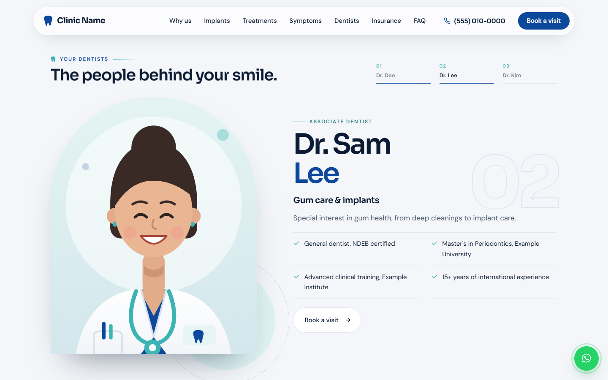

# Dental Clinic Landing Page: Design Spec

A reusable layout spec for a single-page dental clinic site. Every name, number, address and person below is **dummy content**. Swap in the real clinic's details when a project starts.

- **Page type:** one long landing page, 21 sections + global UI
- **Feel:** clean, premium, calm. Porcelain neutrals, one navy anchor colour, teal for "live" or active states.
- **Stack:** plain HTML/CSS/JS in one `index.html`, plus GSAP, ScrollTrigger, Lenis and Three.js from a CDN.

---

## Preview

Rendered from the dummy-content build at 1440×900 (desktop) and 390×844 (mobile). All logos, names and numbers are placeholders.


<details>
<summary><b>All desktop sections</b></summary>

| | |
|---|---|
| **Hero**<br> | **Crossing divider + stats**<br> |
| **Why us bento**<br> | **3D implant, step 1**<br> |
| **3D implant, step 2**<br> | **3D implant, step 3**<br> |
| **Treatments**<br> | **Aligner slider (pinned)**<br> |
| **Symptom finder**<br> | **Dentists, scroll stage 1**<br> |
| **Dentists, scroll stage 2**<br> | **First visit**<br> |
| **Insurance**<br> | **Emergency**<br> |
| **Care tips (pinned)**<br> | **FAQ**<br> |
| **Visit + map**<br> | **Refer a patient**<br> |
| **Booking form**<br> | **Footer**<br> |

</details>

### Mobile

<p>    </p>

---

## 1. Design tokens

### Colour

| Token | Value | Use |
|---|---|---|
| `--bg` | `#F4F6F9` | Page background |
| `--paper` | `#FFFFFF` | Cards, form surfaces |
| `--ink` | `#0B1B33` | Headings, strong text |
| `--body` | `#4D5B70` | Body text |
| `--muted` | `#7A879A` | Captions, labels |
| `--line` | `#E2E7EE` | Borders, dividers |
| `--navy` | `#0C489C` | Brand colour, primary buttons |
| `--navy-x` | `#071E44` | Dark sections, deep panels |
| `--teal` | `#3CB4B4` | Accents, live dots, progress |
| `--teal-l` | `#DFF3F2` | Soft tinted panels |
| `--gum` | `#F2C9C2` | Warm blush accent (hero info bar, kids card) |
| Emergency coral | `#F29A8B` | Emergency section accents only |
| WhatsApp green | `#25D366` | WhatsApp button only |

### Type

| Role | Family | Notes |
|---|---|---|
| Display | **Sora** 400–700 | Headings, names, big numbers. Letter-spacing −0.035em to −0.055em |
| Body | **DM Sans** 400–600 | Paragraphs, UI text |

| Style | Size |
|---|---|
| Hero H1 | `clamp(2.4rem, 5.6vw, 5.6rem)` |
| Section H2 (`.h2`) | `clamp(1.9rem, 4.2vw, 3.6rem)` |
| Lede | `clamp(1.05rem, 1.35vw, 1.2rem)` |
| Body | `1.0625rem` (17px) |
| Section label | 12px, uppercase, letter-spacing .16em |

### Spacing and layout

| Token | Value |
|---|---|
| `--wrap` | 1280px (1440 at ≥1700, 1760 at ≥2400, 2240 at ≥3200) |
| `--gut` | `clamp(16px, 4vw, 40px)` |
| `--sp-sec` | `clamp(64px, 8vw, 128px)`, vertical padding per section |
| `--sp-head` | `clamp(32px, 4vw, 56px)`, heading block to content |
| `--sp-gap` | `clamp(14px, 1.6vw, 22px)`, gap inside heading blocks |
| Radius | Cards 20–30px, pills 999px, arch frames `999px 999px 28px 28px` |
| Root font scale | 106.25% at ≥1920, 125% at ≥2400, 150% at ≥3200 |

### Breakpoints

`320 · 375 · 430 · 480 · 560 · 600 · 640 · 768 · 900 · 1024 · 1180/1260 (nav) · 1440 · 1920 · 2560+`

Pinned scroll scenes only run on screens **≥ 901px wide and ≥ 640–680px tall**. Smaller screens get stacked layouts.

---

## 2. Signature elements

1. **Section label:** a small teal tooth icon, an UPPERCASE label and a short fading teal line. No pill background.
   `🦷 YOUR DENTISTS ———`
2. **Arch frame:** photos sit in rounded-top "arch" frames (hero tiles, dentist portraits).
3. **Ribbon divider:** giant outlined words that drift sideways, a teal wave line that draws itself on scroll, and a navy dot that rides the wave. Used 3 times, each one slightly different.
4. **Live status:** a teal pulsing dot plus "Open now / Opens today at 11 am", worked out from the clinic's time zone.
5. **Tooth mark:** the logo silhouette, reused as icons, marquee separators and the preloader.

---

## 3. Global UI

| Element | Behaviour |
|---|---|
| **Preloader** | Navy screen. The tooth outline draws itself, a 000→100 counter runs, then the screen lifts up like a curtain (~1.2s). CSS fallback hides it after 4s. |
| **Nav** | Floating glass pill, `top:16px`, max width 1280. Order: logo → 7 links → phone (icon + number) → "Book a visit". Hides when scrolling down, shows when scrolling up. Links collapse below 1260px; the phone becomes an icon below 560px. |
| **Cursor** (mouse only) | A 6px teal dot follows instantly. A 34px ring trails behind it, snaps onto buttons and takes their shape, becomes an 84px label disc ("Open" / "Drag") on media, turns white on dark sections, and hides over text inputs. |
| **WhatsApp** | Desktop: a 58px green floating button, bottom right, with a pulse ring; on hover it opens to "Chat on WhatsApp". Mobile: the first slot in the bottom bar. Prefilled message: "Hi [Clinic Name], I'd like to book a visit." |
| **Mobile bar** (≤700px) | Bottom glass pill that appears after scrolling 60% of a screen: `[WhatsApp] [Call us] [Book a visit]`. |
| **Smooth scroll** | Lenis (duration 1.15). Anchor links scroll with an offset of −90px. |

---

## 4. Section by section

Each block below has the layout, the dummy content and the motion.

### 01 · Hero

```
┌──────────────────────────────────────────────────────────────┐
│ 🦷 FAMILY DENTISTRY IN [CITY] ──         ▢ ▢ ▣ ▢ ▢  ← 5 arch │
│ Your whole (◐) smile,                    photo tiles         │
│ cared for under one roof.                (center tallest)    │
│ Lede, 2–3 lines                         ┌────────────────┐   │
│ [Book your visit →] [Call (555)…]       │● Open now · 9–6 │→ │  ← blush "gum" bar
│                                         └────────────────┘   │
│ ─────────────────────────────────────────────────────────── │
│ ⏱ Open 7 days   💳 Insurance billed directly   ✓ … · Scroll │
└──────────────────────────────────────────────────────────────┘
```

- **Left:** label, H1 with a small inline pill photo between words, lede, two CTAs.
- **Right ("smile row"):** 5 photo tiles in arch shapes, heights `.7 / .86 / 1 / .88 / .72`, sitting on a blush info bar (live status, address, phone, round arrow button). Hovering a tile lifts it and shows a white label above it with a pointer. The info bar always stays on top.
- **Dummy content**
  - H1: *Your whole smile, cared for under one roof.*
  - Lede: *Check-ups, braces, root canals, implants and wisdom teeth, all handled by our own team. No referrals across the city, and we're open every day.*
  - Tile labels: Clear aligners · Consultations · Healthy smiles · Treatment rooms · Digital X-rays
  - Bar: *Open daily 9–6 · 123 Example Street · (555) 010-0000*
- **Motion:** heading words rise; tiles rise from the centre outwards; the info bar fades in.
- **Mobile:** single column, tiles in a row below the copy, the bar becomes a white card.

### 02 · Crossing divider

- Two rotated bands that cross in an X: **navy** in front (−angle), **teal** behind (+angle). Both are clearly visible on each side.
- Band height ~72–84px on desktop, 44–54px on mobile. Angle 2.8–4° on desktop, 5–9° on tablet and mobile. Total height ≤ 240px.
- Each band is a seamless marquee of service names with tooth-icon separators. The two bands move in opposite directions.
- **Dummy words:** *Implants · Wisdom teeth · Root canals · Clear aligners · Braces · Kids' dentistry · Emergencies* / *Check-ups · Cleanings · Fillings · Crowns · Whitening · Veneers*

### 03 · Stats band

- 4 cells in a row (2×2 on mobile), separated by hairlines. Hovering a cell draws a teal underline.
- **Dummy:** `15+` years in practice · `3` dentists in one office · `7` days a week · `9 hrs` open daily
- **Motion:** numbers count up.

### 04 · Why us (bento)

```
┌──────────── photo, 4 cols × 2 rows ────────────┬── navy clock ──┐
│ IN-HOUSE SURGERY                               │ Open when      │
│ Surgery without the waiting list.              │ you're free.   │
│ chips: Implants · Wisdom teeth · …             ├── teal ticket ─┤
│                                                │ Insurance,     │
│                                                │ billed for you │
├────────── Anxious? (text + photo) ─────────────┼─ Kids (blush) ─┤
```

- 5 cards with 3D tilt and glare on hover.
- The clock card shows real local time with hands.
- The ticket card has an animated "claim sent" bar.

### 05 · Implant story (3D, sticky)

- Dark navy section, `300vh` tall, with a sticky `100svh` frame.
- **Left:** label, H2, 3-segment progress, 3 step texts that crossfade.
- **Right:** a Three.js scene that lives **inside** the section, so it is clipped to it.
  1. A natural molar slowly rotates.
  2. It fades out and a titanium implant with a gold abutment rises in.
  3. A ceramic crown descends and seats on top.
- Labels with leader lines: Natural root · Titanium implant · Abutment · Ceramic crown.
- **Dummy steps:**
  - *STEP 01 · ASSESS: When a tooth can't be saved*
  - *STEP 02 · PLACE: A titanium post replaces the root*
  - *STEP 03 · RESTORE: A crown that feels like yours*
- **Fallback:** a static SVG when WebGL isn't available. Reduced motion jumps between the 3 stages.

### 06 · Treatments (expanding strips)

- 6 tall photo strips in a row. The active strip grows to about 4× width and shows its title, a one-line description and a round arrow. Collapsed strips show a vertical title.
- Height `clamp(400px, 62vh, 560px)`. On mobile they stack, and the active strip is 380px tall.
- **Dummy:** Dental implants · Braces & aligners · Root canals · Wisdom teeth · Whitening & veneers · Check-ups & cleanings

### 07 · Ribbon divider: "habits"

- Outlined words: **Brush • Floss • Smile • Repeat**. "Smile" is filled navy.
- The wave draws **left → right** and the words drift left.

### 08 · Aligner simulator (pinned)

- **Left:** H2, lede, two compare cards (Clear aligners / Traditional braces), CTA.
- **Right:** an SVG illustration of a gum line and 10 teeth, plus a slider, a percentage and stage tags (Start / Trays moving teeth / Finished). It is labelled "Illustration".
- **Desktop:** the section pins, and scrolling moves the teeth from crooked to straight, 0 → 100%. Dragging the slider scrolls the page to match, so the slider and the scroll never disagree.
- **Mobile:** no pin; the illustration follows the scroll and the slider can be dragged.
- **Dummy H2:** *Straighter, one small step at a time.*

### 09 · Symptom finder

- **Left:** 8 toggle chips in 2 columns.
- **Right:** a navy result card: "You picked", a title, a suggested visit pill, an explanation, an "In the meantime" tip, a "Book this visit" button (which preselects the booking reason) and the line "A guide, not a diagnosis."
- **Dummy chips:** Toothache · Bleeding gums · Sensitive to cold · Crooked teeth · A missing tooth · Wisdom tooth pain · Want whiter teeth · My child's first visit

### 10 · Dentists (sticky scroll stage)

```
┌──────────────────────────────────────────────────────────────┐
│ 🦷 YOUR DENTISTS ──                  01 Dr. Doe  02  03       │
│ The people behind your smile.        ▬▬▬▬▬▬▬▬  ──   ──        │
│                                                              │
│   ╭──────────╮      — PRINCIPAL DENTIST          ⓪①          │
│   │  arch    │      Dr. Jane                                 │
│   │ portrait │      Doe            ← 2nd line in navy        │
│   │          │      Implants & oral surgery                  │
│   ╰──────────╯      One-line bio                             │
│     ◯ teal dot      ✓ cred  ✓ cred / ✓ cred  ✓ cred          │
│                     [Book a visit →]                         │
└──────────────────────────────────────────────────────────────┘
```

- **Desktop:** the section is `300vh` tall with a sticky frame. Scrolling swaps the dentist: the old portrait wipes upward, the new one rises from the bottom in the **same arch frame**, and the text leaves fully before the next text arrives. Progress tabs on the right fill as you scroll; clicking one scrolls to that dentist.
- **Mobile and short screens:** stacked rows, alternating left and right, each revealing on scroll.
- **Dummy dentists:**

| # | Name | Role | Focus | Credentials |
|---|---|---|---|---|
| 01 | Dr. Jane Doe | Principal dentist | Implants & oral surgery | DDS, Example University · Residency in oral surgery · 15+ years in practice · Member, Dental Association |
| 02 | Dr. Sam Lee | Associate dentist | Gum care & implants | General dentist, board certified · Master's in Periodontics · Advanced clinical training · 10+ years of experience |
| 03 | Dr. Alex Kim | Associate dentist | Everyday dentistry | DMD, Example University · Registered with the dental college |

- **Missing photo:** use a flat cartoon illustration with a small "Illustration" label until a real portrait arrives.

### 11 · Ribbon divider: "trust"

- **Meet • Trust • Care • Smile**. "Care" is filled teal-dark and the separators are navy.
- A different, longer wave that draws **right → left**; the words drift the other way.

### 12 · First visit (timeline)

- **Left:** a sticky photo with a caption chip ("Your first visit · About 30 minutes").
- **Right:** H2 and lede, then a vertical timeline whose line fills as you scroll and whose numbered dots turn navy, then a "What to bring" chip list.
- **Dummy steps:** ~5 min *Say hello at the desk* · ~10 min *Digital X-rays* · ~15 min *A full examination* · Take-home *Your plan, on paper*

### 13 · Insurance and costs

- 4 cards in a row: paper, mint, navy and ink. On desktop they start fanned out like playing cards and straighten as you scroll.
- **Dummy:** *You have a plan · You have no plan · You're on a government plan · Plans change mid-treatment*, each with a chip ("Direct billing", "Written estimate", …).

### 14 · Emergency band

- Ink-dark band with expanding coral pulse rings on the right.
- H2 *Toothache? Don't wait it out.*, a large phone number with a coral underline that grows on hover, and symptom chips.

### 15 · Tips (horizontal scroll)

- **Desktop:** the section pins and vertical scroll moves 6 tip cards sideways, stopping exactly at the last card. The arrow buttons jump between cards.
- **Mobile:** a native swipe carousel with snap.
- **Dummy tips:** *Two minutes, twice a day · Floss once a day · New brush every 3 months · Easy on sugary drinks · Guard up for sports · Keep your check-ups*

### 16 · FAQ

- **Left (sticky):** label, H2, a "Call" button.
- **Right:** 7 accordion rows. The "+" turns into a navy "×"; the answer opens with a smooth height animation.
- **Dummy questions:** new patients · weekend hours · direct billing · government plan · in-house surgery · nervous patients · parking.

### 17 · Visit (map and hours)

- **Left:** a stylised SVG street map (two crossing roads, a pulsing pin, a parking marker, "Not to scale") with 3D tilt.
- **Right:** H2, live status, a 7-row hours table with today highlighted, the address, and a "Get directions" button.
- **Dummy:** *123 Example Street, Unit 4, City, ST 00000 · Mon–Sun 9:00 am – 6:00 pm*

### 18 · Refer a patient

```
┌ head (label, H2, lede) ─────────┬ 01 Send ─ 02 We phone ─ 03 We see ┐
├ navy urgent card + Call button  ┬ ┌ Dentist referral form (header) ──┐ ┤
│ teal "Often referred to us"     │ │ Referring dentist: 4 fields      │ │
│ chips                           │ │ Patient: 4 fields + dropdown     │ │
│ 2 patient cards with icons      │ │ How soon: 3 chips · note · ☐     │ │
│ email line                      │ │ [Send referral →]                │ │
└─────────────────────────────────┴─┴──────────────────────────────────┘
```

- The "Referred for" dropdown is a **custom listbox**: grouped options, a search box (shown when there are more than 8 options), keyboard support, a check mark on the chosen option, and a flip-up when there isn't room below.

### 19 · Ribbon divider: "start"

- **Your Smile • Starts Here**. The phrases alternate between solid navy and outlined.
- Bigger type, a thicker wave, a dotted ghost wave behind it, and **two dots** (navy, plus a smaller teal one trailing). Height ≤ 300px.

### 20 · Booking

- **Left (sticky):** label, H2 *Pick a time that suits you.*, lede.
- **Right:** form with name and phone, "What's it for?" chips, "Best time" chips, an insurance dropdown (custom listbox) and a "Request a time" button.
- Validation messages appear inline; on success a confirmation note appears ("This is a preview, nothing was sent").

### 21 · Footer

1. **Navy CTA card:** a large *See you in the chair.*, the phone number, live status and "Book a visit". A soft teal glow drifts across the background.
2. **Badges strip:** a white card with 3 partner or association logos separated by hairlines (stacked on mobile).
3. **Columns:** logo and address · Treatments · Patients · Hours.
4. **Giant wordmark:** an outlined `[Brand]` that fills with navy as you scroll.
5. **Legal row:**
   - Left: `© 2026 [Clinic Name] · [Principal dentist]` and any trademark notice.
   - Right: `Powered by: [Agency]` and "Back to top ↑".

---

## 5. Motion rules

- **Library split:** GSAP and ScrollTrigger for anything tied to scroll; CSS transitions for hover; Lenis for smooth scrolling.
- **Easing:** `cubic-bezier(.22,.8,.2,1)` for UI. Use `expo.out` for entrances and `expo.inOut` for clip reveals.
- **Headings:** split into words that rise from a mask (`yPercent: 120 → 0`).
- **Pins:** use `gsap.matchMedia` so pins only run on large enough screens and clean up when the screen changes size. Pinned sections set `refreshPriority`. Call `ScrollTrigger.refresh()` after images and fonts load.
- **Never animate opacity alone to hide something out of bounds:** clip it with the layout instead (for example, the 3D canvas lives inside its section).
- **Reduced motion:** no marquees, no idle loops, no pins. Sliders and carousels still work by hand.
- **No JS:** content stays readable; the native `<select>` stays usable.

---

## 6. Accessibility checklist

- Every section label, heading and button is real text; decorative SVGs use `aria-hidden`.
- Custom dropdown: `aria-haspopup="listbox"`, `aria-expanded`, `aria-activedescendant`, and arrow / Home / End / Enter / Escape / type-ahead keys.
- Tabs and progress buttons are keyboard reachable; hidden dentist slides are `inert`.
- A visible focus ring (2px teal) on everything.
- Forms use real `<label for>`; errors are announced in a live note.
- Colour contrast: navy on white, white on navy, ink on blush all pass AA.

---

## 7. Assets needed per project

| Asset | Spec |
|---|---|
| Logo (horizontal) | PNG or SVG, ~600×160, transparent |
| Wordmark (footer) | PNG or SVG; will be shown white on navy |
| Dentist portraits | Portrait JPG, at least 640×800, face in the top third |
| Hero tiles | 5 photos, at least 600px wide, mixed subjects (patient, room, equipment) |
| Treatment strips | 6 photos, at least 1200px wide |
| Badges | 3 association or partner logos, PNG/SVG/WebP |
| Clinic facts | Name, phone, WhatsApp number, email, address, hours, time zone, services, insurance notes |

---

## 8. Placeholder copy bank

- **Clinic:** [Clinic Name] · [City] · (555) 010-0000 · hello@example.com
- **Hours:** Open every day, 9:00 am – 6:00 pm
- **Address:** 123 Example Street, Unit 4, City, ST 00000
- **Short CTA lines:** *Book your visit* · *Request a time* · *Send referral* · *Chat on WhatsApp* · *Get directions*
- **Trust lines:** *No referrals across the city* · *Insurance billed directly* · *New patients always welcome* · *A guide, not a diagnosis*
